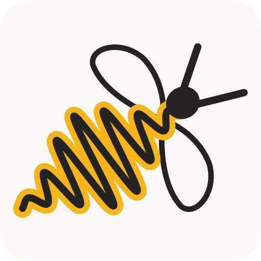

<div align="center">
  <picture>
    <source media="(prefers-color-scheme: dark)" srcset="docs/assets/beamax-logo-tile.png">
    <source media="(prefers-color-scheme: light)" srcset="docs/assets/beamax-logo.svg">
    
  </picture>
</div>

# beamax

[](https://github.com/elma16/beamax/actions/workflows/run-tests.yml)
[](https://codecov.io/gh/elma16/beamax)

[Installation](#installation) | [Documentation](https://elma16.github.io/beamax/) | [Examples](https://elma16.github.io/beamax/examples/)

beamax is a [JAX](https://github.com/jax-ml/jax) library for photoacoustic tomography with multiscale Gaussian beams. It provides:

- dyadic Fourier decompositions and multiscale wave-packet transforms
- forward, adjoint, and time-reversal MSGB solvers
- hybrid low- and high-frequency composition and optional k-Wave integration
- CPU, GPU, and TPU execution through JAX.

## Installation

Python 3.12 or newer is required. Install JAX for your hardware using the [official instructions](https://docs.jax.dev/en/latest/installation.html), then install beamax:

```bash
pip install beamax
```

Optional extras provide plotting and k-Wave support:

```bash
pip install "beamax[viz-mpl]"
pip install "beamax[kwave]"
```

Use `KWaveSolver(backend="cpp")` for native k-Wave on the CPU (the default),
`backend="python"` for the Python solver, or `backend="mac"` for Metal on
Apple silicon with macOS 15 or newer. The backend applies to forward
simulation, time reversal, and the adjoint. The first Metal solve downloads
and verifies the executable, which later runs reuse.
MSGB uses JAX separately. The experimental `jax-mps` plugin accelerated
single-precision homogeneous forward propagation on an M4. Use CPU for the
MSGB reconstruction examples. [Apple silicon setup and benchmark](docs/guides/kwave-metal.md)

## Examples

- [Decompose an initial pressure field](examples/wave-packets/2d_packet_selection.py) and see
  how much accuracy you retain with 16 or 64 wave-packet coefficients. This
  uses the base installation.
- [Simulate a 2D measurement](examples/forward/2d_forward_comparison.ipynb)
  with MSGB and k-Wave. Compare the pressure at a line of receivers.
- Reconstruct the same two sources with [time reversal](examples/reconstruction/2d_time_reversal.ipynb)
  or [the adjoint](examples/reconstruction/2d_adjoint.ipynb). Each notebook times MSGB and k-Wave.

See the [example gallery](docs/examples/index.md) for setup, Colab notebooks
and examples of ray bending, autodiff and absorption.

For development setup and tests, see [CONTRIBUTING.md](CONTRIBUTING.md).

## Reference

- Jianliang Qian and Lexing Ying, ["Fast Multiscale Gaussian Wavepacket Transforms and Multiscale Gaussian Beams for the Wave Equation"](https://doi.org/10.1137/100787313), *Multiscale Modeling & Simulation*, 8(5), 1803-1837, 2010. [Full text (PDF)](https://stanford.edu/~lexing/GBwave.pdf)
- Michele Berra, Maarten V. de Hoop, and José Luis Romero, "A multi-scale Gaussian beam parametrix for the wave equation: The Dirichlet boundary value problem", *Journal of Differential Equations*, 309, 949–993, 2022. [Published article](https://doi.org/10.1016/j.jde.2021.11.043) · [Open preprint](https://arxiv.org/abs/1705.00337)

Related acoustic simulation projects include [k-Wave](https://github.com/ucl-bug/k-wave), [k-Wave-python](https://github.com/waltsims/k-wave-python), and [j-Wave](https://github.com/ucl-bug/jwave).

## Citation and license

If you use beamax, please cite this repository. For MSWPT/MSGB, also cite Qian and Ying (2010). For Gaussian beam matching at the detector boundary in time reversal, cite Berra, de Hoop, and Romero (2022). beamax is released under the [MIT license](LICENSE).
