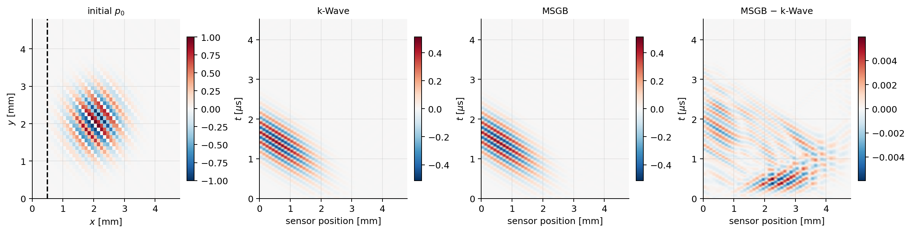

# Forward propagation

## MSGB vs k-Wave

Launch an oscillating Gaussian pressure packet on a 48 × 48 grid with a
constant sound speed of 1,500 m/s. Both solvers record at the same 48
receivers. Each column of the resulting array is one receiver's pressure
trace over time. Requires `beamax[kwave,viz-mpl]`.



The two records share a colour scale. The residual has its own scale so that
small differences are visible. With the default 512 selected coefficients,
a CPU run gave 227 time samples and a relative L2 difference of 0.0114.
Change `thr` in `MSGBSolver` to see how the packet budget affects this record.

[](https://colab.research.google.com/github/elma16/beamax/blob/v0.4.0/examples/forward/2d_forward_comparison.ipynb)

```python
--8<-- "examples/forward/2d_forward_comparison.py"
```
