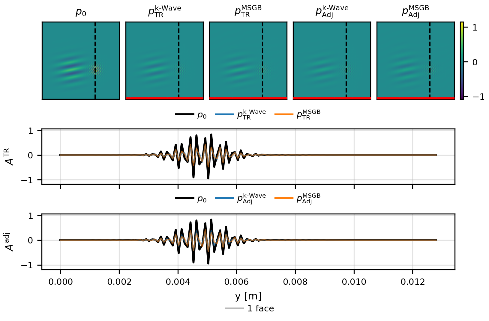

# Reconstruction

## One-face time reversal and adjoint

Run the Chapter 5 homogeneous box scanner with its first detector face. k-Wave
records the mixed two-packet source on 128 boundary nodes of the open 128 × 128
grid with a 20-cell external absorbing layer. Both operations use that acquisition.
MSGB uses the thesis 256 × 128 detector-data transform and closed-form
homogeneous propagation. The notebook prints first-call and repeat runtimes for
the acquisition and each of the four reconstructions.

The five panels show the initial pressure, k-Wave and MSGB time reversal, and
k-Wave and MSGB adjoints. Red triangles mark the detectors. The two profiles
use column 87 (zero-based), the dashed line in the thesis. The shared colour
and profile limits come from the four-face plate. Its display factor of
2,296.52776, fitted to the four-face k-Wave adjoint, applies to both displayed
adjoints. The arrays returned by the solvers keep their physical amplitudes.



[](https://colab.research.google.com/github/elma16/beamax/blob/v0.4.0/examples/reconstruction/2d_time_reversal_and_adjoint.ipynb)

```python
--8<-- "examples/reconstruction/2d_time_reversal_and_adjoint.py"
```

## Time reversal

Run just the time-reversal pair to see how much of the initial pressure a single
face recovers. The panels use the same image scale and profile as the combined figure.

[](https://colab.research.google.com/github/elma16/beamax/blob/v0.4.0/examples/reconstruction/2d_time_reversal.ipynb)


```python
--8<-- "examples/reconstruction/2d_time_reversal.py"
```

## Adjoint

Apply the two surface adjoints to the same pressure record and compare their
relative gains along the marked line. The panels use the combined figure’s adjoint
display factor.

[](https://colab.research.google.com/github/elma16/beamax/blob/v0.4.0/examples/reconstruction/2d_adjoint.ipynb)


```python
--8<-- "examples/reconstruction/2d_adjoint.py"
```
