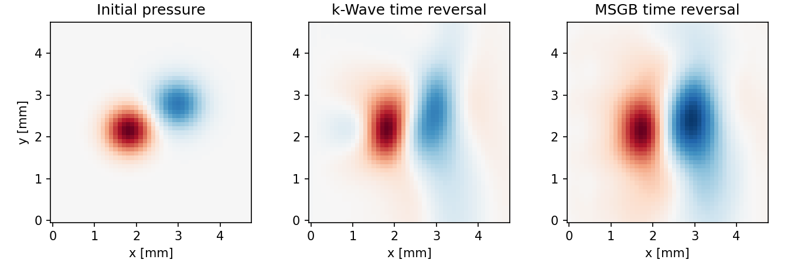
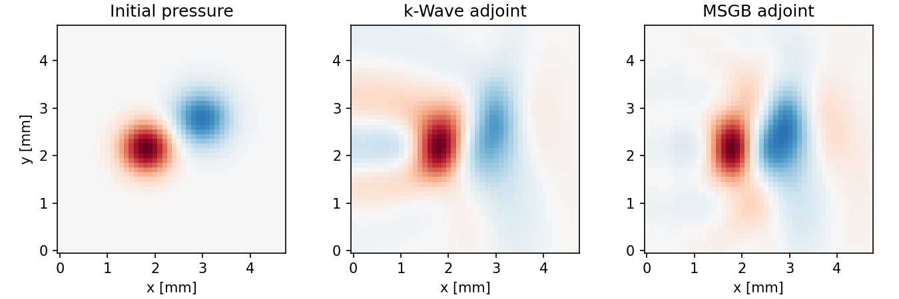

# Reconstruction

Both short examples start from the same two pressure sources and record 192 time
samples at 48 receivers on the left edge of the image. Each applies MSGB and
k-Wave to the original recordings. The plots scale each panel by its own peak
magnitude so you can compare source locations, shapes and polarity.

## Time reversal

Propagate the measured boundary pressure backwards to reconstruct the initial pressure.

[](https://colab.research.google.com/github/elma16/beamax/blob/v0.4.0/examples/reconstruction/2d_time_reversal.ipynb)



```python
--8<-- "examples/reconstruction/2d_time_reversal.py"
```

## Adjoint

Backproject the detector data using the Euclidean pairing for both solvers. MSGB approximates the PAT adjoint with Gaussian beams.

[](https://colab.research.google.com/github/elma16/beamax/blob/v0.4.0/examples/reconstruction/2d_adjoint.ipynb)



```python
--8<-- "examples/reconstruction/2d_adjoint.py"
```

## 2D time reversal and adjoint

A detector line on one side of a 64 × 64 grid records the signal from two
Gaussian pressure sources of opposite sign. k-Wave generates the measurements.
Time reversal propagates the recordings backwards. The PAT adjoint maps
receiver data back to the image using the adjoint of the measurement model.
The example applies both operations with each solver. Requires
`beamax[kwave,viz-mpl]`.


Compare the source locations and the widths and signs of the peaks in the
line profiles. The script resamples the records in time for MSGB and fits one
scalar per reconstructed image to the known phantom before plotting and
reporting relative L2 error. Those errors measure agreement in image shape
after scaling. Testing an adjoint identity requires a separate dot-product
test with the chosen data and image inner products.

[](https://colab.research.google.com/github/elma16/beamax/blob/v0.4.0/examples/reconstruction/2d_time_reversal_and_adjoint.ipynb)

```python
--8<-- "examples/reconstruction/2d_time_reversal_and_adjoint.py"
```
